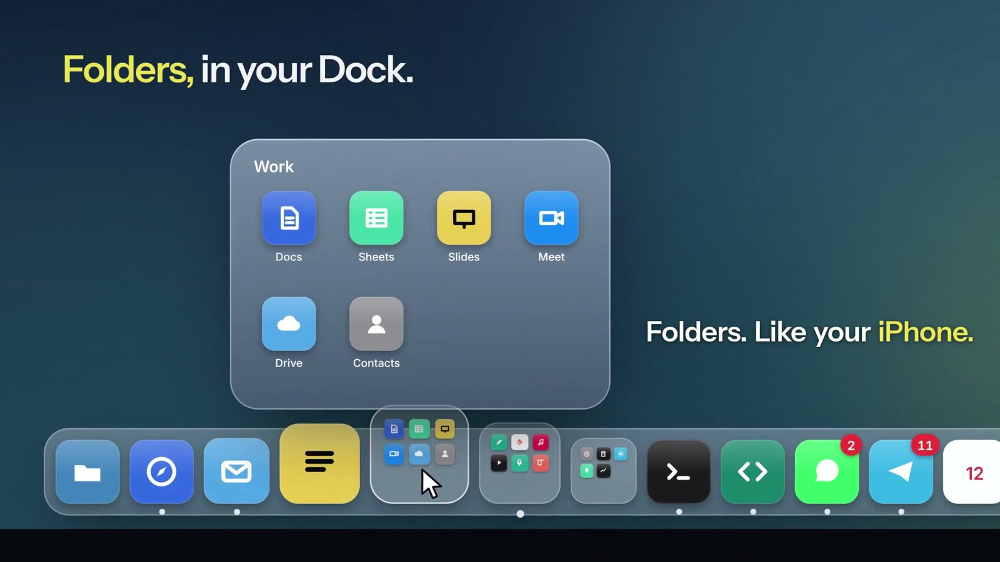
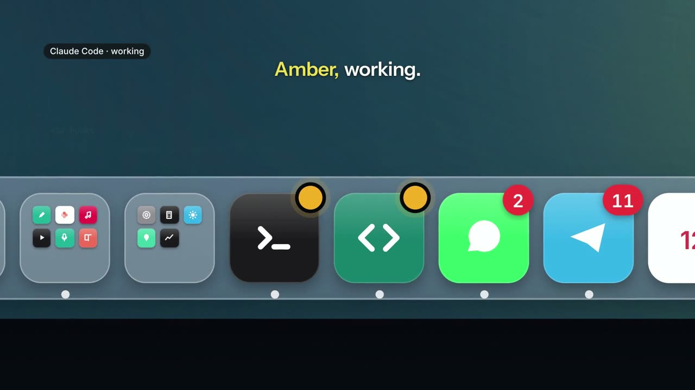

<div align="center">


# BetterDock

**The macOS Dock, finally organised.**

iPhone-style folders, live status for your AI agents, widgets and themes.<br>
Apps in a folder never clutter your Dock again, even while they run.

[](LICENSE)
[](#requirements)
[](Sources)
[](#performance)

[**Website**](https://betterdock.vercel.app) · [**Watch the film**](https://betterdock.vercel.app) · [**Install**](#install)

<br>

<a href="https://betterdock.vercel.app"></a>

</div>

<br>

## Why

The Dock fills up. Every app you run takes a spot, and there is no way to group the ones you keep together. BetterDock gives the Dock folders, and apps inside a folder stay inside it, running or not. Apple's Dock keeps working in the background, so Cmd-Tab, Mission Control and app badges behave exactly as before. It just never appears.

## Features

<table>
<tr>
<td width="50%" valign="top">

### 📁 Folders
A folder springs open above its tile. Hover for half a second to peek. Right-click any app for **New Folder**, drag apps in and back out, rename it, give it a colour.

</td>
<td width="50%" valign="top">

### 🟠 Agent status
A dot on the app your Claude Code or Codex agent runs in: **amber** while it works, **green** when it's done, **red** when it needs you. A soft sound when one needs you while the Dock is hidden.

</td>
</tr>
<tr>
<td valign="top">

### 📊 Widgets
Now Playing, **AI Usage** (weekly Claude and Codex limits), Calendar, Weather, Clock, Focus Timer, System, Network, Storage, Battery and Agents. Each one Small, Medium or Large.

</td>
<td valign="top">

### 🎨 Make it yours
Five themes (Glass, Graphite, Paper, Midnight and Wallpaper, tinted to your desktop) and Default, Dark, Clear and Tinted icon styles drawn from the variants macOS designs for each app.

</td>
</tr>
<tr>
<td valign="top">

### ✋ Drag and drop
Reorder with a drag, drop an app on a folder to file it, drag a running app in to keep it, pull one up and away to remove it. Drop files on an app to open them with it.

</td>
<td valign="top">

### 🗑️ A real Trash
Full or empty at a glance. Click to open, drop files to delete, right-click to empty.

</td>
</tr>
<tr>
<td valign="top">

### 🔀 Profiles
Work, Personal and Focus layouts, each with its own icons, folders and widgets. Switch from the menu, or let them switch by time of day or Wi-Fi network.

</td>
<td valign="top">

### 🖥️ Every display
The Dock follows you to whichever screen you push the cursor to the bottom of, like Apple's. A short setup on first launch gets you going.

</td>
</tr>
</table>

<div align="center">

</div>

## Performance

BetterDock is native Swift and SwiftUI with no dependencies. Looping animations run in the system's render server, polling stops while the Dock is hidden, and nothing runs while your cursor is away from the bottom of the screen.

| | CPU |
|---|---|
| Hidden | **0.0%** |
| On screen, with widgets and a glowing agent dot | **~0.1%** |
| Rendering one frame while magnifying | **~2 ms** |

## Requirements

- macOS 14 or later on Apple silicon
- Xcode Command Line Tools: `xcode-select --install`

## Install

**The easy way:** ask your coding agent (Claude Code, Codex, Cursor…):

> Install BetterDock by following https://github.com/Bilal-Bjo/betterdock/blob/main/INSTALL.md

**By hand:**

```bash
git clone https://github.com/Bilal-Bjo/betterdock.git
cd betterdock
./install.sh --try   # build and run once: nothing is installed, Apple's Dock stays
./install.sh         # install, start at login, hide Apple's Dock
```

To remove BetterDock and bring Apple's Dock back exactly as it was:

```bash
./uninstall.sh
```

<details>
<summary><b>What happens to Apple's Dock</b></summary>

<br>

`./install.sh` hides Apple's Dock for good: it sets a very long auto-hide delay, so pushing the cursor to the edge never reveals it, and makes it as small as possible for the one place macOS still forces it on screen, Mission Control. Apple's Dock keeps running in the background, which keeps Cmd-Tab, Mission Control and app badges working. Your original Dock settings are saved to `config/apple-dock-backup.plist` first.

To do it by hand instead:

```bash
defaults write com.apple.dock autohide -bool true
defaults write com.apple.dock autohide-delay -float 1000
killall Dock
```

</details>

<details>
<summary><b>Permissions and privacy</b></summary>

<br>

Every permission is optional.

- **Accessibility:** reads unread badges from Apple's Dock.
- **Automation:** Spotify or Music for the Now Playing widget, Finder for the Trash.
- **Calendar:** your next event in the Calendar widget.

There is no account and no analytics. The only network requests are album art for Now Playing and the weather from Open-Meteo for the city in your Mac's time zone.

To check what each widget reads on your Mac:

```bash
~/Applications/BetterDock.app/Contents/MacOS/BetterDock --widget-test
```

</details>

## Agent status and AI usage

```bash
./hooks/install-hooks.sh
```

This adds hooks to Claude Code (`~/.claude/settings.json`) and Codex (`~/.codex/hooks.json`) and keeps the ones you already have. Each hook records an agent's state, and BetterDock puts the dot on the app the agent runs in: Claude, Terminal, your editor. Codex asks you to trust the new hooks the next time it starts.

The **AI Usage** widget shows this week's limits. Codex usage is read from its local session logs. Claude usage comes from the `rate_limits` Claude Code passes to its status line, which the installer sets up if you don't have a status line yet (Pro and Max plans).

## Configure

Right-click any icon and open **BetterDock** for Profile, Theme, Icon Style, Icon Tint, Icon Size, Magnification, Hide Automatically, Widgets, Agent Sounds, Hide Apple's Dock, Open at Login, Setup…, **Edit Settings…** and **Show Settings in Finder**. Right-click a widget to resize it, a folder to rename or colour it.

Everything is plain JSON in `~/Library/Application Support/BetterDock/` (`config/` in the repo for a developer install), copied from `examples/` on first launch. Save `dock.json` in any editor and the Dock reloads.

<details>
<summary><b>Settings reference</b></summary>

<br>

`dock.json`

```json
{
  "iconSize": 52,
  "magnifiedSize": 84,
  "autohide": true,
  "badges": true,
  "theme": "glass",
  "iconStyle": "default",
  "agentSound": "attention",
  "hidden": ["/Applications/Some Background App.app"],
  "items": [
    { "app": "/System/Library/CoreServices/Finder.app" },
    { "folder": "dev" },
    { "widget": "nowPlaying", "size": "medium" }
  ]
}
```

| Key | Values |
| --- | --- |
| `theme` | `glass`, `graphite`, `paper`, `midnight`, `wallpaper` |
| `iconStyle` | `default`, `dark`, `clear`, `tinted` |
| `iconTint` | `wallpaper`, `yellow`, `blue`, `pink`, `green`, `purple`, `graphite` |
| `agentSound` | `attention` (default), `all`, `off` |
| `items` | the layout: `app`, `folder` or `widget` (with `size`: `small`, `medium`, `large`) |
| `profile`, `profiles` | the current profile, and each profile's saved `items` |
| `profileRules`, `autoProfile` | rules that switch profiles on their own, and whether they run |
| `onboarded` | `true` once setup has been shown |

`folders/dev.json`

```json
{
  "name": "Dev",
  "columns": 4,
  "color": "blue",
  "apps": ["/Applications/Xcode.app", "/System/Applications/Utilities/Terminal.app"],
  "labels": { "/Applications/Xcode.app": "Xcode" }
}
```

A folder's `color` is `graphite` (the default), `red`, `orange`, `yellow`, `green`, `blue` or `purple`.

</details>

<details>
<summary><b>Profiles and switching rules</b></summary>

<br>

**BetterDock ▸ Profile ▸ New Profile…** saves the current layout under a name; from then on each profile keeps its own icons, folders and widgets, and switching swaps them in place. Rules are checked once a minute and when the Mac wakes; the first match wins, and a profile you pick by hand stays until a different rule starts to apply.

```json
"profileRules": [
  { "profile": "Work", "days": ["weekdays"], "from": "09:00", "to": "18:00" },
  { "profile": "Work", "wifi": "Office" },
  { "profile": "Focus", "days": ["sat", "sun"] }
]
```

`days` takes `mon` to `sun`, `weekdays` and `weekends`; a time window may cross midnight. Wi-Fi rules need the network name, which recent macOS versions only share with apps allowed to use Location.

</details>

## How it works

BetterDock is an accessory app that draws a borderless panel at the Dock's window level, on the display you last pushed the cursor to the bottom of. It tracks the cursor with event monitors to reveal, magnify and hide, launches apps through `NSWorkspace`, watches launches and quits to decide which icons to show, and opens at login through `SMAppService`.

```
Sources/
  Shared/Folder.swift          folder model, grid view, panel and motion
  Shared/Theme.swift           the five themes and the wallpaper's dominant colour
  Shared/Status.swift          agent dots, pulses, badges
  Shared/IconStyle.swift       dark, clear and tinted icons
  Shared/SystemIcons.swift     the icon variants macOS renders (IconServices)
  DockApp/main.swift           the Dock: layout, magnification, drag and drop, menus
  DockApp/Live.swift           agent status, unread badges, poof effect
  DockApp/Widgets.swift        widgets and their data sources
  DockApp/Setup.swift          settings folder, login item, hiding and restoring Apple's Dock
  DockApp/Onboarding.swift     first-run setup
  DockApp/Profiles.swift       profiles and their switching rules
  DockApp/Updater.swift        Sparkle updates for release builds
hooks/                         Claude Code and Codex hooks, status line
examples/                      starter configuration
release/, packaging/           signed release builds (see RELEASING.md)
```

Icon styles use IconServices, a private macOS framework, to draw the dark and monochrome icons Apple designs for each app. If a macOS update changes it, BetterDock falls back to its own renderer.

## License

[MIT](LICENSE). Not affiliated with Apple.
